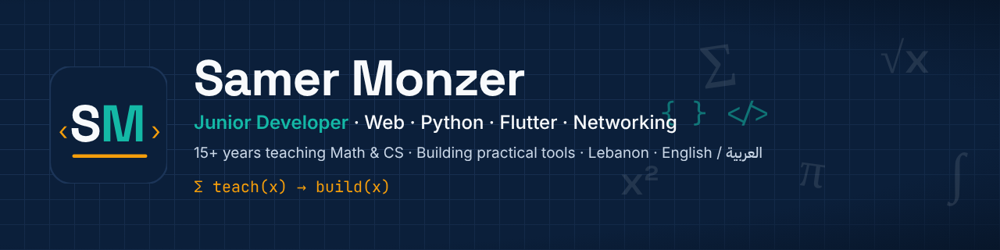

  

<h3 align="center">Teacher turned developer. I build practical tools that solve real problems.</h3>

  
  
  

## About me

- 🎓 **Computer Science graduate.** My senior project was a food delivery app built with a partner.
- 👨‍🏫 **15+ years teaching Mathematics and Computer Science.** I explain complex ideas simply and break big problems into small steps.
- 🛠️ **Self-taught in modern development and networking.** I learn by building and shipping small, tested tools.
- 📚 **Starting a Master's in Computer Science in January 2027.**
- 🌍 **I speak Arabic and English** and build bilingual (RTL) interfaces.
- 🎯 **Looking for:** a junior developer or IT role.

## Tech stack

**Languages** 

**Frameworks and tools** 

**Networking and IT** 

## Featured projects

| Project | What it is | Built with |
| --- | --- | --- |
| [**Solo Calisthenics**](https://github.com/GrandMaster-samer/solo-calisthenics) | Offline-first training app. It plans your week, adapts as you log, keeps data encrypted, and works in English and Arabic (RTL). | Flutter, Dart, Riverpod, Drift + SQLCipher |
| [**Food Delivery App**](https://github.com/GrandMaster-samer/food-delivery-app) | My CS senior project, built with a partner: browse menus, order and track deliveries. | *see repo* |
| [**IPv4 Subnet Calculator**](https://github.com/GrandMaster-samer/subnet-calculator) · [live](https://grandmaster-samer.github.io/subnet-calculator/) | Network, broadcast, host range, binary view and subnet splitting, live in the browser. | JavaScript |
| [**CSV Cleaner**](https://github.com/GrandMaster-samer/csv-cleaner) | Command-line tool that cleans messy CSV files. No dependencies, 13 unit tests. | Python |
| [**Subscription Tracker**](https://github.com/GrandMaster-samer/subscription-tracker) · [live](https://grandmaster-samer.github.io/subscription-tracker/) | Tracks customers, renewals and monthly income, with CSV export. | JavaScript |
| [**Math Quiz**](https://github.com/GrandMaster-samer/math-quiz) · [live](https://grandmaster-samer.github.io/math-quiz/) | Random practice quizzes across 8 topics, built from my classroom experience. | JavaScript |

## GitHub stats

  
  

  

  

## Contact

- **LinkedIn:** [linkedin.com/in/samer-monzer-51266727a](https://www.linkedin.com/in/samer-monzer-51266727a)
- **Languages:** English, Arabic
- **Location:** Lebanon (open to remote)

Σ teach(x) → build(x)

